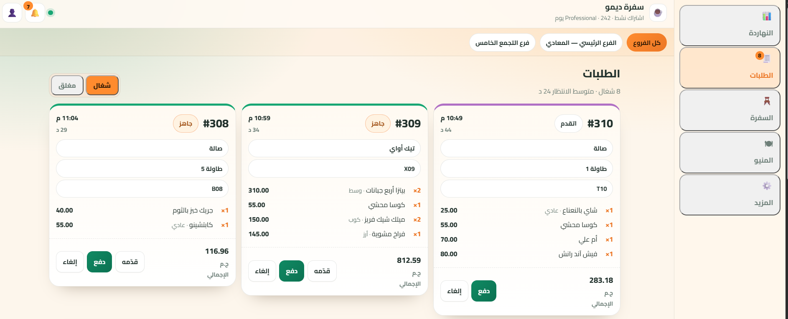
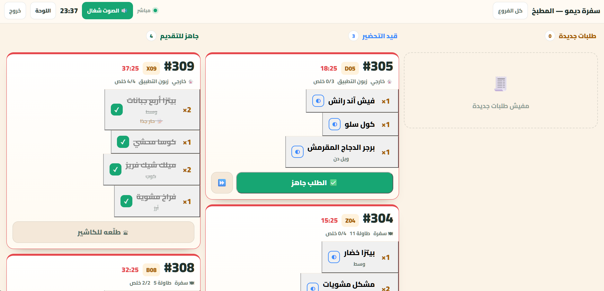
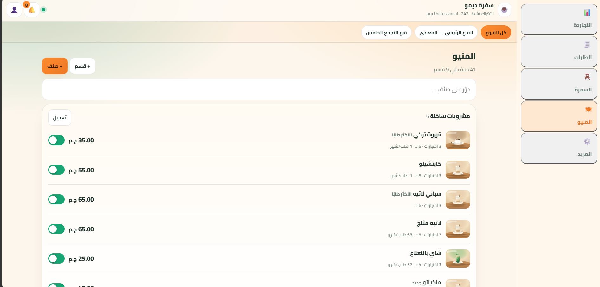

# Sofra — Restaurant Management System

**Product Showcase | Alignerr Review**

Sofra is a restaurant management platform that brings together order management, kitchen operations, and a customer-facing digital menu in one integrated experience.

> **Demo data notice:** The screenshots below were captured from the running application in an isolated demonstration environment using sample data. They do not contain real customer or restaurant operational records.

## 1. Order Management

The Order Management interface gives restaurant staff a clear operational view of active orders, including:

- Order numbers, statuses, and service types.
- Ordered items, quantities, and prices.
- Order totals and operational actions.
- A consolidated view of active orders across the restaurant.

## 2. Kitchen Display System

The Kitchen Display System (KDS) helps kitchen staff follow preparation progress and coordinate order fulfillment.

- Active kitchen orders grouped by preparation status.
- Item-level preparation tracking.
- Clear visibility of orders ready to serve.
- Real-time synchronization with order management.

## 3. Customer-Facing Menu

The customer-facing menu provides a digital interface for browsing menu categories and available food items, viewing descriptions and prices, and exploring the restaurant's offerings.

- Menu categories and food items.
- Item descriptions and pricing.
- A customer-oriented browsing experience.
- Integration with the restaurant ordering workflow.

## Demonstration Environment

All screenshots were captured from a running local demonstration environment backed by a dedicated database named `SofraDemo`. This environment is isolated from the original application database.

## About This Showcase

This repository is a **public, presentation-only showcase** created for product review. It contains this documentation and three application screenshots only; it does not distribute the application's source code, configuration files, credentials, or database.

**Project:** Sofra  
**Category:** Restaurant Management SaaS  
**Review purpose:** Demonstration of actual application interfaces and operational workflows
