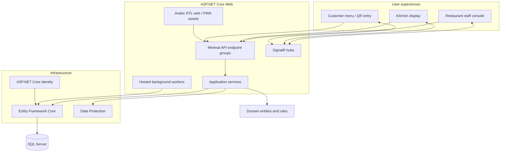

# Sofra — Restaurant Operations Platform

**Product, Architecture & Engineering Showcase**  
*A multi-tenant restaurant operations platform connecting front-of-house workflows, kitchen execution, and customer ordering.*

Sofra brings restaurant staff, kitchen teams, and guests into one connected operational workflow. The product combines order management, a kitchen display experience, customer-facing digital menus, tenant-aware data management, reporting, and real-time operational updates.

This showcase is intended for product and technical review. It highlights the application's implemented capabilities and engineering approach without publishing the private source code.

> **Demonstration data:** The screenshots below were captured from a running application in an isolated demonstration environment backed by a dedicated `SofraDemo` database. They use sample data and do not contain real customer or restaurant operational records.

---

## Product experience

### 1. Order management

A consolidated operational workspace for restaurant staff:

- View active orders, order numbers, statuses, and service types.
- Review ordered items, quantities, prices, and order totals.
- Follow order progress and perform operational actions.
- Keep front-of-house activity connected to kitchen execution.

### 2. Kitchen Display System (KDS)

A focused kitchen interface designed around preparation flow:

- Display active kitchen orders and their preparation states.
- Track preparation progress at order-item level.
- Make orders ready to serve visible to the team.
- Receive live operational updates through the real-time messaging layer.

### 3. Customer-facing digital menu

A guest-oriented menu experience that supports:

- Browsing menu categories and available items.
- Viewing item descriptions and prices.
- Accessing a restaurant menu through its public link or table QR context.
- Connecting the guest ordering journey to the restaurant's order workflow.

---

## Engineering highlights

The following points describe implementation patterns present in the private application repository. They are summarized here for technical review; the source code, configuration, credentials, and database are not part of this public showcase.

### Layered solution structure

The solution is separated into three focused projects rather than placing the entire application in one project:

| Project | Responsibility |
| --- | --- |
| `RestaurantSaaS.Domain` | Core entities, domain concepts, and enums |
| `RestaurantSaaS.Infrastructure` | Entity Framework Core persistence, SQL Server integration, Identity persistence, migrations, and tenant-aware infrastructure |
| `RestaurantSaaS.Web` | ASP.NET Core endpoints, application services, authentication, real-time hubs, background workers, and web/PWA assets |

The dependency structure keeps domain concepts separate from persistence concerns, while the web host composes the application services and infrastructure.

### Multi-tenant data isolation

Tenant separation is enforced below the user-interface layer:

- Tenant context is resolved for incoming requests through a dedicated tenant provider.
- Entity Framework Core global query filters scope tenant-owned records to the current tenant.
- Persistence guards stamp the active tenant identifier onto new tenant-owned records.
- Cross-tenant writes are rejected at the database-context boundary.
- Platform-level access is handled explicitly rather than treating every request as an unrestricted tenant query.
- Tenant-aware indexes and uniqueness constraints support data integrity across restaurants.

This approach is designed to make tenant isolation a persistence concern, not merely a convention followed by individual screens.

### Identity and application security

The application uses ASP.NET Core Identity for user and role persistence, together with JWT bearer authentication for protected API and real-time connections.

Implemented controls include:

- JWT validation for issuer, audience, token lifetime, and signing key.
- Role-based authorization for privileged operations.
- Unique email enforcement and password policy configuration.
- Account lockout after repeated failed login attempts.
- Rate-limiting policies for authentication and tenant registration endpoints.
- Trusted-proxy configuration for forwarded request headers.
- Security response headers, HTTPS redirection, and HSTS outside Development.
- ASP.NET Core Data Protection for stored restaurant gateway credentials.

Security controls are applied in the server pipeline and persistence layer, rather than relying only on client-side behavior.

### Server-authoritative order and pricing rules

Order values are calculated and validated by the backend. Client-submitted prices are not treated as authoritative.

The order rules include:

- Subtotal and monetary rounding.
- Discount limits and coupon eligibility.
- Service charges and tax calculations.
- Delivery-fee rules and free-delivery thresholds.
- Tips and final order totals.
- Preparation-time estimates based on ordered items and queue conditions.
- Validated order-state transitions to prevent invalid workflow jumps.

This keeps important commercial rules consistent across the customer, staff, and kitchen experiences.

### Real-time operations

SignalR connects operational screens to live order activity:

- Dedicated kitchen and customer hubs.
- Live order updates as preparation progresses.
- JWT-based authentication for protected real-time connections.
- A shared order workflow between staff operations and kitchen execution.

### Background automation

Hosted workers handle recurring operational tasks without requiring staff to trigger every process manually. The application includes workers for:

- Kitchen-flow progression.
- Rush and workload monitoring.
- Floor/table monitoring.
- Subscription-state monitoring.
- Daily-cycle and reporting tasks.
- Outbox message processing.

Workers use scoped application services and database contexts, and log failures so a failed processing pass does not silently become a successful operation.

### Messaging, auditability, and privacy

The implementation includes supporting services for operational reliability and data governance:

- An outbox-based guest-message workflow with deduplication keys and delivery states.
- Provider-aware messaging: a message is not represented as successfully sent when no delivery provider is configured or the provider has not confirmed it.
- Audit records for sensitive operations.
- Tenant-aware privacy and data-erasure workflows.
- Time-zone-aware handling for restaurant-local business operations.

### Data model and persistence

The persistence layer uses Entity Framework Core with SQL Server and explicit entity relationships, indexes, and migrations.

Examples of database-level safeguards include unique tenant slugs, QR tokens, tenant-scoped order numbers, and deduplication/provider-event keys. These constraints complement application validation and help protect data integrity when requests overlap.

### Reporting and customer access

The application includes operational analytics and report-export functionality, including CSV output. Reporting distinguishes billed amounts from collected amounts rather than treating every recorded payment attempt as settled revenue.

The customer experience is delivered as a web application with Arabic right-to-left interface support and Progressive Web App assets, including web manifests and service-worker support. QR-code generation supports table-based menu access.

---

## Architecture at a glance

---

## Technology stack

| Area | Technology |
| --- | --- |
| Runtime and framework | .NET 8 / ASP.NET Core 8 |
| Language | C# |
| API approach | ASP.NET Core Minimal APIs |
| Data access | Entity Framework Core 8 |
| Database | Microsoft SQL Server |
| Identity | ASP.NET Core Identity |
| API authentication | JWT Bearer |
| Real-time communication | SignalR |
| API documentation | Swagger / OpenAPI |
| QR code generation | QRCoder |
| Automated tests | xUnit |
| Frontend | HTML, CSS, JavaScript, Arabic RTL |
| Installable web experience | Progressive Web App (PWA) |
| Containers | Docker and Docker Compose |
| Continuous integration | GitHub Actions |

---

## Quality engineering

The private repository contains a dedicated xUnit test project. The test suite includes focused checks for high-impact business and security rules, such as:

- Tenant query isolation and cross-tenant write rejection.
- Order calculations, rounding, coupon rules, and valid order-state transitions.
- Payment-rail availability and the distinction between recording an attempt and settling a payment.
- Gateway credential protection.
- Guest-message outbox behavior and deduplication.
- Privacy and tenant data-erasure behavior.
- Time-zone and link-handling rules.
- Reporting and export behavior.

A GitHub Actions workflow builds the web project and runs the automated test project on pushes and pull requests. The project also includes Docker and Docker Compose assets for a repeatable application-and-SQL-Server development environment, with database health checks and persistent volumes.

The showcase intentionally does not publish a fixed test count or coverage percentage: those figures should be taken from a specific, reproducible test run rather than inferred from the presence of test files.

---

## Integration boundaries and current scope

The project distinguishes implemented workflows from integrations that still require provider-side completion and deployment validation.

- **Online payment confirmation:** Paymob and Fawry configuration points exist, and online payment attempts are kept distinct from collected funds. A completed automatic provider callback/webhook confirmation path is not yet part of the current implementation. Online payment attempts must therefore not be interpreted as automatically settled.
- **Subscription billing:** Subscription plans and lifecycle states are represented, but automated subscription invoicing, renewal charging, and collection are not implemented.
- **Guest messaging:** The outbox workflow is implemented; actual delivery requires a configured external provider endpoint and valid provider credentials.
- **Wallet payments:** A wallet balance and wallet payment flow are not implemented.
- **PDF reports:** Reports can be printed from the browser; dedicated server-side PDF generation is not currently implemented.
- **Native mobile distribution:** The web/PWA experience exists. Native app-store packaging or TWA distribution is a separate release activity.
- **Production operations:** A live deployment still requires environment-specific secrets, durable Data Protection keys, verified backup and restore procedures, TLS/reverse-proxy configuration, monitoring, and provider testing.

These boundaries are stated explicitly so that the showcase describes the actual implementation rather than implying unfinished integrations are production-ready.

---

## Demonstration and repository scope

All three screenshots are from the running application in an isolated demonstration environment backed by the dedicated `SofraDemo` database.

This public repository is a **presentation-only showcase**. It contains this README and the three product screenshots only. It does not contain or distribute:

- Application source code.
- Application or deployment configuration.
- Credentials, API keys, or private secrets.
- Database files, customer records, or restaurant operational data.

The production application repository remains private and separate from this showcase.

---

**Project:** Sofra  
**Category:** Multi-tenant Restaurant Operations Platform  
**Showcase purpose:** Product demonstration and technical review  
